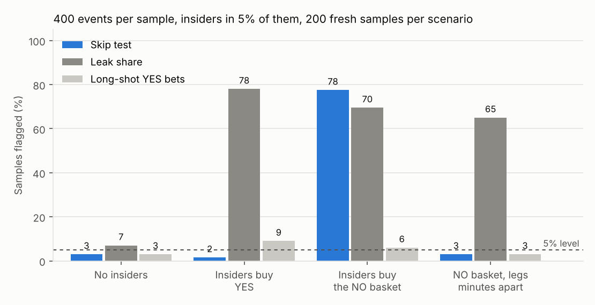

# Where do event contracts leak?

Tools to measure, from public trade data alone, three things a prediction-market venue needs to know about informed trading:

1. **Where** the answer reaches the price in the last day before a scheduled reveal, by contract family (the *leak share*).
2. **Which route** informed money takes: the *mirror trade*, and a test that finds it in anonymous trades (the *skip test*).
3. **What it costs** in spread: the *leakage tax*, and the insider share it implies.

Kalshi's public trades carry the taker's side but no account, so everything here works on anonymous flow. It complements, not replaces, what a venue sees with accounts: pre-listing risk scores, employer checks and account-level investigations.

## The three measures

**Leak share.** For a window before the reveal R (the primary one: 24h to 1h out), the share of the remaining Brier score that disappears inside the window:

$$L = 1 - \frac{\sum_j (Y_j - P_j(R-1\text{h}))^2}{\sum_j (Y_j - P_j(R-24\text{h}))^2}$$

If prices are martingales, the expected drop equals the variance of the price move, so *L* is the share of remaining uncertainty resolved in the window. For contracts whose answer is fixed before a scheduled reveal (award winners, what a prepared speech says, whether a named person shows up) and no public news is due, any *L* above zero is information arriving early: a leak, or a legitimate preview. Families are compared side by side: in continuous-public contracts (games, index levels) a large *L* near close is just news. Equal price noise at both edges pulls *L* toward zero; a stale start price pushes it up (it carries earlier news into the window), so a market enters a window only if it traded in the 12 hours before the window opens. The idea follows work on price drift before scheduled macroeconomic releases ([Kurov, Sancetta, Strasser and Wolfe, JFQA 2019](https://pure.royalholloway.ac.uk/en/publications/price-drift-before-us-macroeconomic-news-private-information-abou)), applied by contract family.

**The mirror trade.** In an event with *N* mutually exclusive outcomes priced p₁…p_N, someone who knows the winner *w* can buy one YES on *w* (profit 1 − p_w) or one NO on every other outcome (cost N − 2 + p_w, payout N − 1, profit 1 − p_w when prices sum to 1; with the usual overround the basket earns slightly more). Before fees the two are worth the same; the basket ties up more capital and pays more spreads, which is the price of hiding. No leg is a long shot unless a rival trades above 65¢ (its NO then costs under 35¢), so a screen keyed on large long-shot YES bets reads none of it (`mirror.mirror_profits`). It is the prediction-market cousin of "shadow trading" ([SEC v. Panuwat](https://www.paulweiss.com/insights/client-memos/federal-jury-finds-defendant-liable-in-sec-shadow-trading-case)): the information is about one outcome, the trades are in its siblings.

With accounts or wallets the fix is direct: net each account's legs within an event into one bet on the outcome it left out, then screen net exposure. On Polymarket's neg-risk markets a NO share already converts into YES shares on every other outcome, so the netting is natural there.

**Skip test** (anonymous trades). NO-taker trades on two or more outcomes of one event within 60 seconds form a basket. A basket that skips some outcomes says "the winner is among the skipped". If baskets carry no information beyond prices, the skipped set wins with probability equal to its share of recalibrated prices. The test sums (skipped set won − its price share) over baskets and simulates the null by redrawing each event's winner from prices. Complete baskets (arbitrage) carry no signal and are ignored. Prices are recalibrated per family (logistic in log-odds, cross-fitted by event) because favourites win more often than their prices say, and an uninformed trader who sells long shots skips favourites. Two placebos guard the real-data result: the same test one to two weeks before the reveal, and on continuous-public events.

**Leakage tax.** Taker markout to settlement plus the effective half-spread is what takers earn beyond paying the spread. Its rise from one-to-two weeks out to the day before the reveal is the extra half-spread makers need in that day to break even on what leaked. In Glosten–Milgrom with insiders who know the answer and uninformed flow split evenly, every 1% of order flow that knows the outcome adds 0.5¢ to the break-even half-spread at 50¢ (0.18¢ at 10¢), paid by uninformed takers (`python3 -m leakage.spread`). Bartlett and O'Hara ([2026](https://conference.nber.org/conf_papers/f243677.pdf)) price adverse selection by market type over whole market lives; this isolates the last day before a reveal.

## Does it work? Fresh simulated samples with planted insiders

`synth.py` builds Kalshi-shaped events: public information enters as exact posteriors, displayed prices add a favourite-longshot bias and the push of uninformed takers who lean YES, and some uninformed traders sell long shots in baskets or buy complete baskets as arbitrage. In a share of events an insider learns the answer 2–48 hours before the reveal and makes about 5 trades of median 150 contracts (noise traders: 20), each moving the price 0.30 in log-odds for good. In binary events the insider buys the winning side; in multi-outcome events, YES on the winner or the NO basket.

`power.py` simulates 200 fresh samples per scenario, 400 events each (half binary, half 3–8 outcomes), insiders in 5% of events, and runs each one-sided 5% test on the day before the reveal:



| Scenario | Skip test | Leak share | Long-shot YES bets |
|---|---:|---:|---:|
| No insiders (false alarms) | 3% | 7% | 3% |
| Insiders buy YES | 2% | 78% | 9% |
| Insiders buy the NO basket, legs seconds apart | 78% | 70% | 6% |
| Same basket, legs 2–10 minutes apart | 3% | 65% | 3% |

Each rate is ±2–3 points (200 samples). The skip test fires on the NO basket and on nothing else; the leak share sees every kind of leak but not its route. A basket whose legs are minutes apart escapes the burst rule; with accounts, netting catches it. The long-shot column is a test built on a screen's trigger (each market's largest YES bet at 35¢ or less, if in the top 5% of sizes), not a real surveillance system, which looks at individual bets with account data: it cannot see NO legs by construction, and its weak showing against YES insiders reflects this simulation's many uninformed long-shot buyers.

Recalibration is what keeps the skip test honest. `python3 -m leakage.recalibration_check` runs 60 clean samples with a strong favourite-longshot bias shaped so a two-parameter recalibration cannot fit it exactly. On raw prices the skipped outcomes win 1.09 times as often as prices say and the test false-alarms in 28% of samples; recalibrated, the ratio is 1.00 and false alarms fall to 7%.

`python3 -m leakage.run --synthetic` runs the full report on a planted displacement story: insiders buy YES before 2026-06-09 and switch to baskets after it. The skip test is silent before the switch and fires after it. [Demo report](demo_report/report.md).

## Run it on Kalshi

Needs Python 3.10+, numpy, pandas, scipy, matplotlib. The pull is standard library only and uses public, unauthenticated endpoints (live and historical tiers).

```bash
# 1. pull settled scheduled-reveal series plus comparison families (resumable)
python3 -m leakage.kalshi_pull --out data/kalshi --since 2025-06-01 --min-volume 500 \
    --discover mention,award,oscar,grammy,emmy,nobel,attend,draft,nominee,cpi,fed
python3 -m leakage.kalshi_pull --out data/kalshi --since 2025-06-01 --min-volume 500 \
    --series KXBTCD,KXHIGHNY

# 2. check leakage/report/families.csv, then read the report
python3 -m leakage.run --data data/kalshi --split-date 2026-06-09 --out leakage/report

# tests (22, about 10 seconds)
python3 -m unittest discover -s leakage/tests -t .
```

The [Becker prediction-market dataset](https://github.com/Jon-Becker/prediction-market-analysis) (Kalshi trades to March 2026, parquet) also loads directly: `--data path/to/data/kalshi` (needs pyarrow). It has no event metadata, so multi-outcome events are inferred, and it ends before June 2026, so it cannot test H2.

Read [PREREGISTRATION.md](PREREGISTRATION.md) first: hypotheses, windows, placebos and decision rules are fixed there. Commit it before the first real run; the commit time is the registration time.

## Files

| File | What it does |
|---|---|
| `kalshi_pull.py` | Pulls settled events, markets and public trades (live and historical tiers), resumable |
| `data.py` | Loads a pull folder or Becker parquet into one normalised shape |
| `families.py` | The family table: series ticker → scheduled reveal / scheduled data / continuous public / elections |
| `metrics.py` | Leak share, markouts, effective spread, event-clustered intervals |
| `mirror.py` | Mirror-trade identity, recalibration, skip test, long-shot test |
| `spread.py` | Glosten–Milgrom with insiders; leakage tax |
| `synth.py`, `power.py`, `recalibration_check.py` | Planted-leak simulation, detection rates, recalibration check |
| `run.py` | One command from data to `report.md` |

## Limits

- The leak share measures information arriving before the reveal through any channel. Released excerpts, press previews and nowcasts are legitimate. The map says where to look; accounts say who.
- A basket is inferred from timing in anonymous data. A patient insider who spreads legs over minutes escapes the burst rule (table above); the leak share still sees the price move, and account-level netting catches the position.
- Last-trade prices are stale in thin markets; quote midpoints from Kalshi's candlesticks would be better at window edges.
- Reveal time is the earliest close in the event. It is right for awards and for mention markets, which close word by word, and approximate where markets close on a schedule after the answer is known.
- Kalshi's risk scores trigger employer checks, which should themselves cut leakage, so the scores are best checked against markets listed before 2026-06-09.
- Family assignment is a judgment call, made in one table before looking at outcomes.
