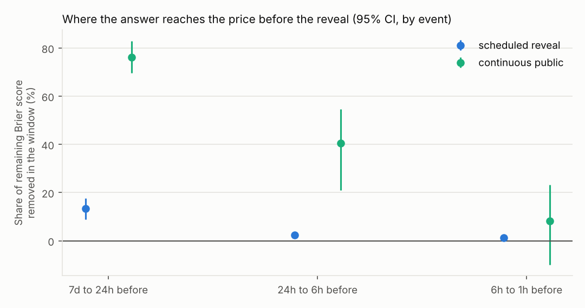

# Leakage report

Source: `synthetic`. 1,200 settled events, 3,344 markets, 186,498 trades. Reveal time = earliest close in the event. Intervals resample whole events.

## 1. Families (check these first)

Assigned from series tickers by `families.py`; override with `--families-csv`.

| family | subfamily | series | events | markets | multi_outcome |
|---|---|---|---|---|---|
| continuous_public | sports | SYNRACE | 155 | 874 | 1.00 |
| continuous_public | sports | SYNGAME | 245 | 245 | 0.00 |
| scheduled_reveal | award | SYNAWARD | 309 | 1734 | 1.00 |
| scheduled_reveal | named_person | SYNATTEND | 491 | 491 | 0.00 |

## 2. Leak share before the reveal

Share of the remaining Brier score that disappears inside each window. Where no public news is due before the reveal it should be near zero. Markets whose last trade before a window is more than 12 hours old are left out of that window.

| family | window | events | markets | brier_start_per_event | leak_share | se | ci_lo | ci_hi | z |
|---|---|---|---|---|---|---|---|---|---|
| scheduled_reveal | 7d-24h | 699 | 1550 | 0.256 | 0.134 | 0.023 | 0.088 | 0.175 | 5.763 |
| scheduled_reveal | 24h-6h | 786 | 2047 | 0.248 | 0.023 | 0.006 | 0.012 | 0.035 | 4.062 |
| scheduled_reveal | 6h-1h | 788 | 2078 | 0.243 | 0.013 | 0.004 | 0.005 | 0.020 | 3.159 |
| scheduled_reveal | 24h-1h | 786 | 2047 | 0.248 | 0.035 | 0.007 | 0.021 | 0.049 | 4.970 |
| continuous_public | 7d-24h | 345 | 793 | 0.230 | 0.762 | 0.034 | 0.696 | 0.829 | 22.701 |
| continuous_public | 24h-6h | 395 | 1045 | 0.058 | 0.404 | 0.083 | 0.210 | 0.546 | 4.870 |
| continuous_public | 6h-1h | 393 | 1062 | 0.035 | 0.082 | 0.084 | -0.099 | 0.232 | 0.970 |
| continuous_public | 24h-1h | 395 | 1045 | 0.058 | 0.457 | 0.079 | 0.294 | 0.602 | 5.770 |

By subfamily:

| family | subfamily | window | events | markets | brier_start_per_event | leak_share | se | ci_lo | ci_hi | z |
|---|---|---|---|---|---|---|---|---|---|---|
| scheduled_reveal | named_person | 7d-24h | 391 | 391 | 0.159 | 0.131 | 0.028 | 0.076 | 0.187 | 4.700 |
| scheduled_reveal | named_person | 24h-6h | 477 | 477 | 0.136 | 0.028 | 0.011 | 0.007 | 0.049 | 2.590 |
| scheduled_reveal | named_person | 6h-1h | 479 | 479 | 0.132 | 0.019 | 0.008 | 0.005 | 0.035 | 2.430 |
| scheduled_reveal | named_person | 24h-1h | 477 | 477 | 0.136 | 0.046 | 0.013 | 0.020 | 0.073 | 3.420 |
| scheduled_reveal | award | 24h-6h | 309 | 1570 | 0.422 | 0.021 | 0.007 | 0.008 | 0.034 | 3.132 |
| scheduled_reveal | award | 6h-1h | 309 | 1599 | 0.414 | 0.009 | 0.004 | 0.001 | 0.019 | 2.084 |
| scheduled_reveal | award | 24h-1h | 309 | 1570 | 0.422 | 0.029 | 0.008 | 0.014 | 0.046 | 3.636 |
| scheduled_reveal | award | 7d-24h | 308 | 1159 | 0.379 | 0.136 | 0.032 | 0.070 | 0.199 | 4.184 |
| continuous_public | sports | 7d-24h | 345 | 793 | 0.230 | 0.762 | 0.034 | 0.696 | 0.829 | 22.701 |
| continuous_public | sports | 24h-6h | 395 | 1045 | 0.058 | 0.404 | 0.083 | 0.210 | 0.546 | 4.870 |
| continuous_public | sports | 6h-1h | 393 | 1062 | 0.035 | 0.082 | 0.084 | -0.099 | 0.232 | 0.970 |
| continuous_public | sports | 24h-1h | 395 | 1045 | 0.058 | 0.457 | 0.079 | 0.294 | 0.602 | 5.770 |

Robustness, 24h-1h with no age limit:

| family | window | events | markets | brier_start_per_event | leak_share | se | ci_lo | ci_hi | z |
|---|---|---|---|---|---|---|---|---|---|
| scheduled_reveal | 24h-1h | 800 | 2225 | 0.255 | 0.033 | 0.007 | 0.019 | 0.046 | 4.876 |
| continuous_public | 24h-1h | 400 | 1119 | 0.059 | 0.467 | 0.078 | 0.295 | 0.610 | 6.028 |

## 3. What takers earn, and the spread it implies

Markout per contract to settlement (cents), mean effective half-spread, and their sum: what takers earn beyond paying the spread.

| family | window | events | trades | contracts | markout_c | se_c | ci_lo_c | ci_hi_c | half_spread_c | net_of_spread_c |
|---|---|---|---|---|---|---|---|---|---|---|
| scheduled_reveal | 7d-24h | 800 | 75752 | 2522916.000 | -1.028 | 0.263 | -1.539 | -0.515 | 1.234 | 0.206 |
| continuous_public | 7d-24h | 400 | 37869 | 1240085.000 | -1.201 | 0.199 | -1.565 | -0.774 | 0.902 | -0.299 |
| scheduled_reveal | 24h-6h | 795 | 15459 | 559056.000 | 0.130 | 0.533 | -0.912 | 1.140 | 1.262 | 1.392 |
| continuous_public | 24h-6h | 397 | 7588 | 243023.000 | -0.508 | 0.208 | -0.875 | -0.090 | 0.895 | 0.387 |
| scheduled_reveal | 6h-1h | 733 | 4605 | 183005.000 | 1.060 | 1.051 | -0.867 | 3.059 | 1.091 | 2.151 |
| continuous_public | 6h-1h | 367 | 2248 | 72382.000 | 0.066 | 0.359 | -0.616 | 0.789 | 0.900 | 0.966 |
| scheduled_reveal | 24h-1h | 798 | 20064 | 742061.000 | 0.360 | 0.506 | -0.632 | 1.343 | 1.226 | 1.586 |
| continuous_public | 24h-1h | 400 | 9836 | 315405.000 | -0.376 | 0.183 | -0.717 | -0.021 | 0.896 | 0.520 |
| scheduled_reveal | 14d-7d | 800 | 27417 | 884945.000 | -1.849 | 0.390 | -2.559 | -1.117 | 1.500 | -0.349 |
| continuous_public | 14d-7d | 400 | 14143 | 454496.000 | -1.576 | 0.542 | -2.598 | -0.502 |  |  |

Leakage tax: rise in net-of-spread markout from the 14d-7d window to the 24h-1h window, with the Glosten-Milgrom insider share it implies at 50c.

| family | net_pre_c | net_base_c | tax_c | implied_insider_share |
|---|---|---|---|---|
| scheduled_reveal | 1.586 | -0.349 | 1.936 | 0.039 |
| continuous_public | 0.520 |  |  |  |

## 4. Mirror trade and long-shot tests (day before the reveal)

Skip test: NO baskets across an event's outcomes; do the skipped outcomes win more often than recalibrated prices say? Long-shot test: large YES bets at 35c or less; do they win more often than prices say? One-sided p-values from simulated nulls.

| period | skip_events | skip_bursts | skip_hit_ratio | skip_p | longshot_markets | longshot_hit_ratio | longshot_p |
|---|---|---|---|---|---|---|---|
| all | 137 | 225 | 1.166 | 0.000 | 444 | 1.057 | 0.408 |
| before 2026-06-09 | 89 | 113 | 1.035 | 0.274 | 301 | 1.242 | 0.183 |
| after 2026-06-09 | 48 | 112 | 1.306 | 0.000 | 150 | 0.812 | 0.800 |

Placebos for the skip test (should not fire; if one does, the result above does not count):

| placebo | events | bursts | hit_ratio | p |
|---|---|---|---|---|
| scheduled reveal, 14d-7d before | 127 | 173 | 0.940 | 0.771 |
| continuous public, 24h-1h before | 51 | 63 | 1.028 | 0.308 |

## Planted truth (synthetic run)

| family | style | events |
|---|---|---|
| continuous_public | none | 400 |
| scheduled_reveal | basket | 43 |
| scheduled_reveal | none | 721 |
| scheduled_reveal | yes | 36 |
