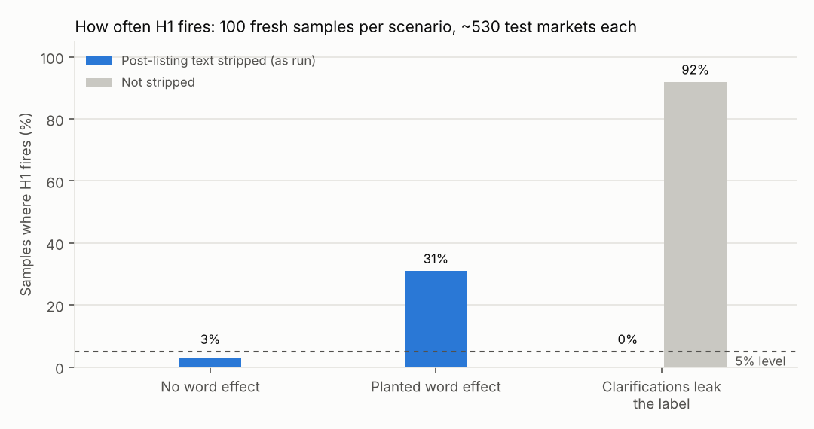
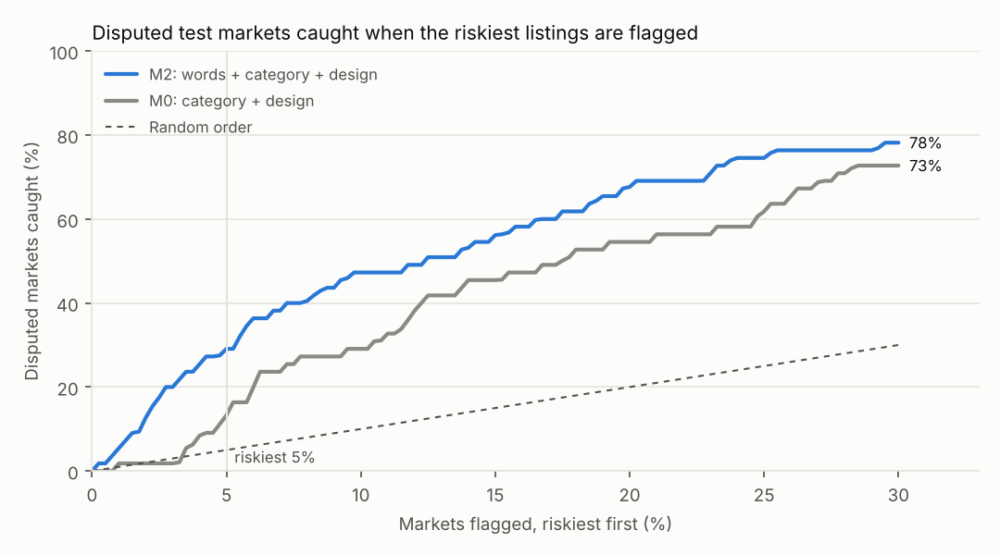

# Which market rules end up disputed?

A prediction market is only as good as its rules. When they leave a case open (does a framework count as a deal? the sale or the filing that reveals it?), the market ends in a dispute, and on Polymarket a dispute goes to a vote of UMA token holders. Disputes are rare but growing and concentrated where the money is: Bloomberg counted nearly 2,000 disputed Polymarket contracts over the year to May 2026, and 230 contracts with more than $1 billion of volume in April 2026 alone, up from 79 six months earlier ([Bloomberg, May 2026](https://news.bgov.com/crypto/nine-crypto-whales-dominate-polymarket-disputes-worth-billions)).

This folder asks whether the rules themselves, read before the market lists, say which markets will be disputed, and turns the answer into a linter for whoever writes the rules.

1. **A dispute dataset.** Every UMA `DisputePrice` event on Polygon since 2024, joined to its market: the adapter derives a question's id as keccak256 of its ancillary data, so hashing the bytes in the dispute event finds the market exactly. The same bytes are the rules as listed, which never change. Labels are cross-checked against Polymarket's resolution API and Gamma's resolution statuses.
2. **A model, tested the way it would be used.** Trained on markets that closed before a date, scored on markets listed after it, against baselines that already know the category and the market's design. Pre-registered: [PREREGISTRATION.md](PREREGISTRATION.md).
3. **A linter.** Eleven checks that each name a case the rules leave open, show the words that triggered it, and suggest the sentence that closes it; with a trained model, a dispute-risk percentile and the words that pushed it up.

The closest prior work found that LLMs prompted with a market's rules cannot reliably say which markets will be disputed ([Wen, Zhou and Huang, 2026](https://arxiv.org/abs/2604.15674)). This tests a narrower claim with a supervised model and a time split, and says in advance what would count as failure.

## The linter

```text
$ python3 -m resolution.lint --examples        (output shortened)
Rules lint: 'Will Country A and Country B announce a permanent peace deal by March 31?'
4 open questions:
 1. [high] Event or announcement?
      > Will Country A and Country B announce a permanent peace deal by March 31…
      > …B announce a permanent peace deal by March 31, 2026. Otherwise, this market w…
    Why: The rules use announce/confirm/report language and a deadline but do not say whether
         the event, the news of it, or both must land before the deadline. …
    Fix: Say which date governs, e.g. "The event must occur by <deadline> ET. Confirmation
         published up to <N> days later counts if it shows the event occurred by the deadline."
 2. [high] Whose reporting decides?
      > …n source for this market will be a consensus of credible reporting.
 3. [high] Key term not defined
 4. [medium] Deadline without a time zone

Rules lint: 'Will Country A and Country B sign a permanent peace agreement by March 31?'
No open questions found by the checks.
```

The examples in [`examples/`](examples/) are illustrative rules written for this demo, not copied from any venue; the second is the first with every open question closed. With `--model resolution/report/model.pkl` (written by `resolution.run`) the linter adds the model's dispute risk, its percentile among training markets and the words that raised it.

| Check | What it catches |
|---|---|
| Event or announcement? | announce/confirm/report language plus a deadline, with no rule for which date governs |
| Whose reporting decides? | "a consensus of credible reporting" with no named outlets |
| Key term not defined | deal, agreement, ceasefire, permanent, control, similar… with no definition |
| What counts as saying it? | mention markets without rules for plurals, compounds, quotes, recordings |
| Passed, signed or in effect? | a bill, law or regulation with no rule for which stage counts |
| Which number, measured how? | a threshold with no venue, time, close/intraday or revision rule |
| Deadline without a time zone | a date with no time and zone |
| No named resolution source | nothing for the resolver to check against |
| No fallback | nothing for postponement, cancellation or a missing source |
| Degree words / judgment calls | significant, substantial, "spirit of the market", discretion |

## The test

| Model | Sees |
|---|---|
| M0 | category + market design (horizon, neg-risk, outcome labels, UMA bond and reward, custom liveness): everything a listing team knows except the words |
| M1 | M0 + phrase-family counts, the eleven flags, text structure |
| M2 | M1 + TF-IDF on question and rules |
| M3 | M2 + the template's dispute history, from markets that closed before listing |
| M0v, M2v | the same with realized volume, to check the words are not a proxy for size |

**H1**, the primary test, is whether M2 ranks disputed test markets better than M0 (PR-AUC, paired bootstrap over events, one-sided 5%). Gamma serves *current* rules, and Polymarket adds clarifications to some markets after they list, often the disputed ones, so the rules are cut at the first update or clarification marker; the report compares the result with the on-chain listing text, lists the markets where they still differ, and shows what happens without stripping. A placebo gives every market another market's text from the same category and quarter.

## Does it work? Fresh synthetic samples with planted drivers

`synth.py` writes Polymarket-shaped data (Gamma markets, resolution rows and ABI-encoded dispute logs) in which open clauses raise the odds of a dispute and closing clauses lower them, on top of category, volume and event effects; categories differ in how many open clauses they use, so category alone predicts disputes too. Neg-risk markets carry a Gamma question id that differs from the UMA one, so the join has to fall back to the listed text, as it may on real data.

`power.py` draws fresh samples per scenario and runs the H1 test on each: PR-AUC of M2 minus M0, event-cluster bootstrap, one-sided 5%. Open clauses add 0.6 to the log-odds of a dispute and closing clauses take off 0.36.



| Scenario | Samples | Test markets (disputed) | H1 fires |
|---|---:|---:|---:|
| No word effect (false alarms) | 100 | 531 (14) | 3% |
| Planted word effect | 100 | 526 (20) | 31% |
| Planted word effect, larger samples | 30 | 1,779 (69) | 70% |
| No word effect, larger samples | 30 | 1,785 (47) | 3% |
| Clarifications leak the label; post-listing text stripped (as run) | 100 | 532 (13) | 0% |
| Same samples, not stripped | 100 | 532 (13) | 92% |

Rates are ±2–5 points at 100 samples and up to ±9 at 30. Reproduce with `python3 -m resolution.power --reps 100` (about 35 minutes on two cores) and `python3 -m resolution.power --reps 30 --n-events 10000 --scenarios words,none --tag _large`.

The test is honest: with no word effect it fires about as often as a 5% test should or less, and stripping post-listing text is what keeps it so; unstripped, clarifications written after disputes make the words look predictive in 92% of samples. It also needs data: with about 20 disputed test markets a moderate word effect is found a third of the time, with about 70 seven times in ten. Markets listed since April 2026 should supply several hundred disputes (Bloomberg counted 230 disputed contracts in April 2026 alone), so a null result on the real data would mean something.

`python3 -m resolution.run --synthetic` runs the full report on one larger synthetic sample: [demo report](demo_report/REPORT.md).

On that sample (8,184 generated markets; 866 test markets, 55 disputed), M2 lifts PR-AUC from 0.16 (M0) to 0.28 (H1: one-sided p = 0.003) and puts 29% of the disputed test markets in its riskiest 5%, against 13% for M0:



Giving each market another market's text from its category and quarter drops M2 to 0.17, back to M0's level: the words carry the signal, not the mix of markets. Scoring Gamma's unstripped text instead jumps to 0.59, which is the clarification leak the stripping removes. The synthetic clarifications come in six shapes (a dated "Update", a header paragraph with the text below it, an inline "Update 3/5/2026:", "Additional context:", "Clarification:", a bare date); after stripping, the rules match the on-chain listing text for all 376 disputed markets that have it.

## Run it on Polymarket

Needs Python 3.10+, numpy, pandas, scipy, scikit-learn, matplotlib. The pull uses the standard library only and public, unauthenticated endpoints. Commit the pre-registration before pulling.

```bash
pip install numpy pandas scipy scikit-learn matplotlib

# 1. markets, resolution rows and (optional) on-chain disputes; every step resumes
export POLYGON_RPC_URL="https://polygon-mainnet.g.alchemy.com/v2/<free key>"   # optional, faster
python3 -m resolution.pull all --out data/pm --since 2024-01-01 --min-volume 10000

# 2. the study (the pull above can take an hour; this about 10-20 minutes)
python3 -m resolution.run --data data/pm --out resolution/report

# 3. lint any rules with the trained model
python3 -m resolution.lint --model resolution/report/model.pkl --title "..." --rules-file rules.txt
```

Without a Polygon endpoint, `pull all` skips the chain step and the labels come from the Data API and Gamma alone; the report says which sources each market's label used. Public endpoints throttle `eth_getLogs`, and the scan adapts its block range to whatever the provider allows; a free Alchemy or Infura key finishes in minutes.

## Files

| File | What it does |
|---|---|
| `pull.py` | Gamma, Data API and Polygon pullers (resumable, standard library) |
| `keccak.py`, `abi.py` | Keccak-256 (pure-Python fallback), DisputePrice decoding, ancillary-data parsing |
| `data.py` | joins, labels from three sources, population filter, template history |
| `text.py` | post-listing stripping, phrase families, the eleven flags, categories |
| `model.py` | the models, time split, metrics, cluster bootstrap |
| `run.py` | the study and the report |
| `lint.py` | the linter |
| `synth.py`, `power.py`, `plots.py` | synthetic data with planted drivers; how often H1 fires; the two charts |
| `examples/` | illustrative rules for the linter |
| `tests/` | `python3 -m unittest discover -s resolution/tests -t .` (no network; local fakes for every API) |

## Limits

A dispute is a noisy measure of ambiguity: some are bad-faith or "too early" proposals, and whether a market gets disputed also depends on who holds it. Kalshi settles disputes internally and publishes none, so the labels are Polymarket's; the linter's checks are venue-neutral. Stripping post-listing text is a heuristic that cannot catch a clarification with no marker; it is checked against the on-chain listing text where that exists. The Data API's resolution endpoint is new and its row semantics are not fully documented (whether `was_disputed` counts a first challenge), which is why labels come from three sources and the report cross-tabulates them.
